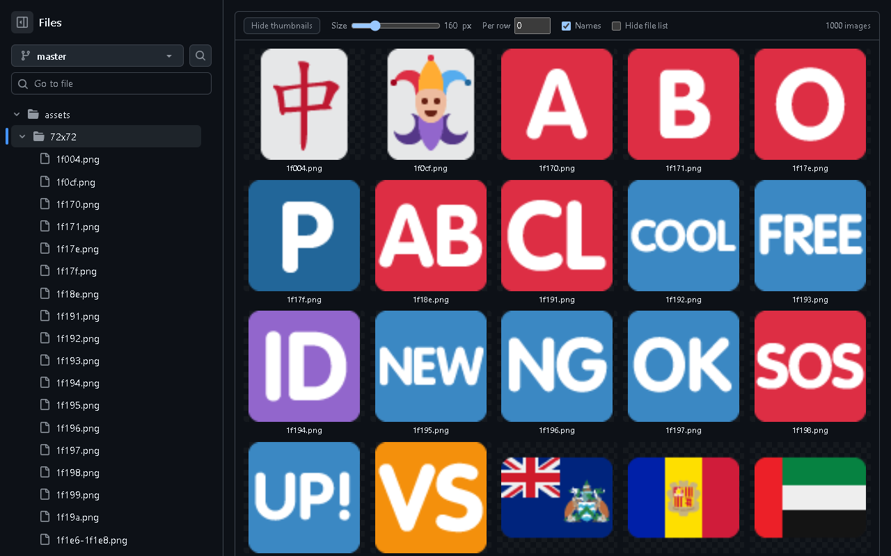
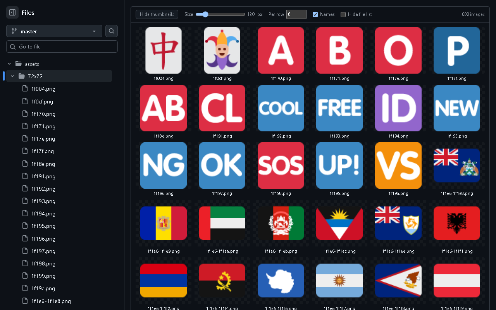
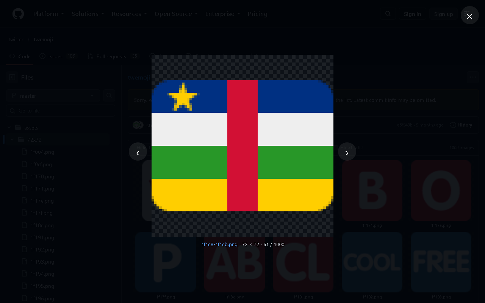

<p align="center">
  
</p>

<h1 align="center">GitHub Image Viewer</h1>

<p align="center">
  <b>See every image in a GitHub folder as a thumbnail gallery.</b><br>
  A free, open-source Chrome extension for previewing PNG, JPG, GIF, SVG and WebP files in GitHub repositories without opening them one by one.
</p>

<p align="center">
  <a href="https://qiangiq.github.io/Github-Image-Viewer/"><b>Website</b></a> ·
  <a href="https://github.com/QIangIQ/Github-Image-Viewer/releases/latest"><b>Download</b></a> ·
  <a href="#install">Install</a> ·
  <a href="#faq">FAQ</a>
</p>

<p align="center">
  
  
  
  
</p>



## Why

On GitHub, a folder of images is just a list of file names. If you work with game assets, sprite sheets, icon sets, screenshots, UI mockups or dataset samples, you end up opening files one at a time to see what they are. GitHub Image Viewer adds a **thumbnail grid** above the file list, so you can see the whole folder at once.

## Features

- **Thumbnail grid** for every image in the current folder: PNG, JPG/JPEG, GIF, SVG, WebP, AVIF, BMP and ICO.
- **Adjustable thumbnail size** from 48 px to 512 px.
- **Images per row**: set an exact column count, or 0 to fit as many as the size allows.
- **Full-size lightbox**: click a thumbnail to view it large, with its pixel dimensions. Use ← and → to browse and Esc to close. Small pixel art is scaled up without blurring.
- **Show or hide file names**, and optionally **hide GitHub's file list** to see only the gallery.
- **Works on private repositories** through your normal GitHub session. No token or OAuth.
- **Follows GitHub's light and dark themes.**
- **Fast on large folders**: thumbnails load lazily as you scroll.
- **Private by design**: no analytics, no servers. Only your grid settings are stored, in your browser.
- Ctrl-click or middle-click a thumbnail to open GitHub's file page in a new tab.

| Fixed images per row | Lightbox |
| --- | --- |
|  |  |

## Install

The Chrome Web Store listing is in review. Until it is live, install it from GitHub:

1. Download the latest `github-image-viewer-*.zip` from [Releases](https://github.com/QIangIQ/Github-Image-Viewer/releases/latest) and unzip it, or clone this repository.
2. Open `chrome://extensions` (Edge: `edge://extensions`, Brave: `brave://extensions`).
3. Turn on **Developer mode**.
4. Click **Load unpacked** and select the `extension` folder.
5. Open any folder on github.com that contains images.

## FAQ

**How do I see image thumbnails in a GitHub repository?**
Install GitHub Image Viewer and open a folder on github.com. All images in that folder appear as a grid above the file list.

**Does it work with private repos?**
Yes. Anything you can open on github.com while signed in also shows as a thumbnail.

**Does it collect data?**
No. See the [privacy policy](https://qiangiq.github.io/Github-Image-Viewer/privacy.html).

**Why do I only see images from one folder?**
The grid shows the folder you are viewing. GitHub lists at most 1,000 files per folder page.

**Which browsers are supported?**
Chrome, Edge, Brave, Opera, Vivaldi and other Chromium-based browsers.

## Project layout

```
extension/   the browser extension (Manifest V3): manifest.json, content.js, content.css, icons/
docs/        landing page, served by GitHub Pages
store/       Chrome Web Store listing text and images
```

## Contributing

Issues and pull requests are welcome. If GitHub changes its page layout and the grid stops appearing, please [open an issue](https://github.com/QIangIQ/Github-Image-Viewer/issues) with the URL of the folder.

## License

[MIT](LICENSE). Not affiliated with or endorsed by GitHub, Inc.

---

<sub>Keywords: GitHub image viewer, GitHub thumbnails, GitHub image preview, GitHub gallery view, view images in a GitHub repo, GitHub folder thumbnails, sprite sheet viewer, game asset browser, Chrome extension for GitHub.</sub>
